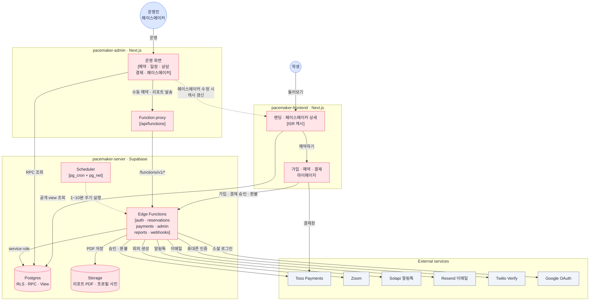

# Pacemaker

**서울대 의·치대 선배와 1:1 공부 멘토링 플랫폼 Pacemaker**를 만드는 팀입니다.

- **Service**: https://www.pincettepacemaker.com

## 📖 About

Pacemaker는 학생이 나보다 먼저 입시를 지나온 선배(페이스메이커)를 고르고, 예약·결제하고, Zoom으로 1:1 상담을 받은 뒤 상담 리포트까지 받아보는 흐름을 하나로 연결한 서비스입니다.
학생용 웹, 운영 어드민, 서버리스 백엔드 3개 레포로 구성되어 있습니다.

1. **탐색**: 페이스메이커 프로필, 후기, 예약 가능 시간을 확인합니다.
2. **예약 · 결제**: 원하는 시간을 잡고 쿠폰을 적용한 뒤 Toss Payments로 결제합니다.
3. **상담**: 상담 전에 사전질문을 작성하고, 예약 시간에 Zoom으로 상담합니다.
4. **리포트**: 상담 녹화와 AI 요약을 바탕으로 정리한 상담 리포트 PDF를 받습니다.

## 🗂️ Repositories

| Repository | 역할 | 주요 기술 |
| --- | --- | --- |
| [**pacemaker-frontend**](https://github.com/Pincette-team/pacemaker-frontend) | 학생용 웹: 랜딩, 페이스메이커 상세, 가입·예약·결제, 마이페이지 | Next.js 16, React 19, Tailwind CSS 4 |
| [**pacemaker-admin**](https://github.com/Pincette-team/pacemaker-admin) | 운영진·페이스메이커용 어드민: 예약·일정·상담·리포트·결제·프로필 관리 | Next.js 15, React 19 |
| [**pacemaker-server**](https://github.com/Pincette-team/pacemaker-server) | 서버리스 백엔드: 인증, 예약·결제, 상담 준비, 리포트, 알림, 정산 | Supabase, PostgreSQL, Deno Edge Functions |

## 🔄 Service Flow

| 단계 | 내용 | 관련 레포 |
| --- | --- | --- |
| 탐색 | 랜딩·상세 페이지에서 페이스메이커 프로필과 후기 확인 | frontend, server |
| 가입 | 이메일 인증 또는 Google 로그인, 휴대폰 인증, 필수 동의 | frontend, server |
| 예약 · 결제 | 시간 hold → 쿠폰 적용 → Toss 결제 → 서버에서 금액 검증 후 확정 | frontend, server |
| 일정 관리 | 페이스메이커가 상담 가능 시간을 열고 닫음 | admin, server |
| 상담 준비 | 상담 24시간 전 Zoom 회의 생성, 사전질문 안내 알림톡 발송 | server |
| 상담 · 리포트 | 녹화 → AI 요약 검수 → 리포트 PDF 발송 → 마이페이지에서 열람 | admin, server, frontend |
| 사후 관리 | 후기 작성 시 할인 쿠폰 지급, 취소·환불, 페이스메이커 정산 기록 | frontend, admin, server |

## 🏛️ System Architecture

- **pacemaker-frontend**는 공개 데이터(페이스메이커·후기)를 Supabase view에서 직접 읽어 캐시하고, 가입·예약·결제·환불은 Edge Functions를 호출합니다.
- **pacemaker-admin**은 조회는 RPC로, 수동 예약·리포트 발송 같은 작업은 같은 origin의 함수 프록시를 거쳐 Edge Functions로 보냅니다. 페이스메이커 정보를 수정하면 프론트 랜딩 캐시를 바로 갱신합니다.
- **pacemaker-server**는 별도 애플리케이션 서버 없이 Supabase(Postgres · RLS · Auth · Storage · Edge Functions) 위에서 동작하며, pg_cron이 hold 만료·상담 준비·알림 발송 같은 작업을 주기적으로 실행합니다.

## 🛠️ Tech Stack

| Category | Stack |
| --- | --- |
| **Frontend** | Next.js 16 (App Router), React 19, TypeScript, Tailwind CSS 4 |
| **Admin** | Next.js 15, React 19, TypeScript |
| **Backend** | Supabase Edge Functions (Deno 2, TypeScript) |
| **Database** | PostgreSQL (Supabase), RLS, RPC, View |
| **Auth** | Supabase Auth, Google OAuth, Twilio Verify |
| **Storage** | Supabase Storage |
| **Scheduler** | pg_cron + pg_net |
| **Payment** | Toss Payments |
| **Meeting** | Zoom API |
| **Notification** | Solapi 카카오 알림톡, Resend 이메일 |
| **Analytics · Security** | Amplitude, Cloudflare Turnstile |
| **CI** | GitHub Actions |

## ✨ Key Features

### 학생용 웹 (pacemaker-frontend)

- 페이스메이커 목록·상세·후기, 좋아요
- 이메일 인증·Google 로그인, 휴대폰 인증, 만 14세 미만 보호자 동의
- 예약 hold, 쿠폰 적용, Toss 결제
- 마이페이지에서 사전질문 작성, Zoom 입장, 리포트 열람, 셀프 취소·환불, 후기 작성
- 한국어 / 영어 전환, 검색엔진 최적화(메타데이터, JSON-LD, 사이트맵)

### 운영 어드민 (pacemaker-admin)

- 역할별 메뉴: 전체 관리자는 전체 운영, 페이스메이커는 본인 예약과 프로필만 관리
- 대시보드, 예약 캘린더, 예약 검색·CSV 내보내기
- 상담 가능 시간 관리, 사전질문 템플릿 편집
- Zoom·상담 노트·AI 요약 관리, 리포트 PDF 발송
- 수동 예약, 결제·환불·취소 처리, 페이스메이커 계정·프로필 관리
- 후기 관리, 자동 작업 수동 실행, 감사 로그

### 서버 (pacemaker-server)

- 결제 금액을 서버에서 계산하고 Toss 승인 금액과 대조한 뒤 예약 확정
- 같은 시간대 중복 예약을 DB 트랜잭션과 제약으로 차단
- 상담 시점별 환불, 페이스메이커 취소 시 보상 무료권, 정산 원장 기록
- 할인 쿠폰, 후기 보상 쿠폰
- 알림톡·이메일 발송 큐, 발송 결과 webhook 반영
- RLS 기반 권한 분리, webhook 서명 검증, 감사 로그
